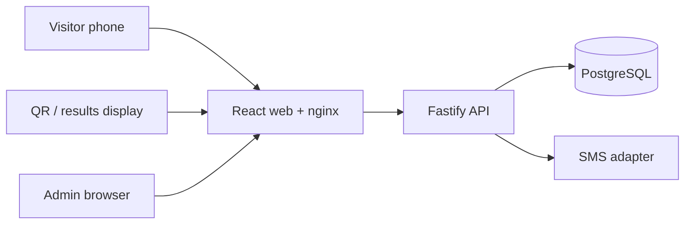

# Maker Collective 2026 Digital Voting System

An end-to-end hackathon prototype for on-site visitor voting at CPF Makerspace’s Maker Collective 2026. It includes a mobile visitor flow, rotating QR entrance display, live TV results, and an admin operations console.

> Status: working prototype. Demo content, credentials, location and SMS are deliberately marked/configured for development; do not deploy the demo configuration to production.

## Quick start

Requires Node.js **20+** and PostgreSQL 15+.

```bash
cp .env.example .env
npm install
npm run db:migrate
npm run db:seed
npm run dev
```

Open `http://localhost:5173` for the visitor app, `/display/results` for TV results, `/display/qr` for the entrance display, and `/admin` for operations. The development mock OTP code is configured as `DEMO_OTP_CODE`; it is never returned from the API or logged.

With Docker (requires Docker Desktop):

```bash
cp .env.example .env
docker compose up --build
```

Then open `http://localhost:8080`.

## Product surfaces

- Visitor: `/` → name, phone and consent → OTP → one vote in each of three categories.
- Presence: `/p/:token` redeems a short-lived signed QR token before the visitor journey.
- TV: `/display/results` maintains an SSE live view; `/display/qr` shows the rotating signed QR.
- Admin: `/admin` controls the voting window, manages core directory data, settings, and exports result totals.

## Important development defaults

`access.policy.mode` seeds as `OFF` only in development to let the demo run without a venue. Production startup refuses mock SMS, local object storage, a demo OTP code, access override, and load-test mode. Event deployment must configure `STRICT`, live SMS, TLS, a real domain, and the confirmed IP/geofence values.

The seeded admin comes from `DEMO_ADMIN_USERNAME` and `DEMO_ADMIN_PASSWORD`. Change it before any shared environment.

## Architecture at a glance



The API is stateless. Sessions, votes, settings and audit records live in PostgreSQL. See [architecture](docs/architecture.md), [security](docs/security-and-anti-fraud.md), [runbook](docs/runbook.md), and the [technical write-up](docs/technical-writeup.md).

## Validation

```bash
npm run build
npm test
```

The tests cover phone normalization, geofence math and rotating-presence token integrity. The remaining pre-event integration, security and load-test checks are listed in `docs/scalability-plan.md` and must be run against a production-like Postgres deployment.
