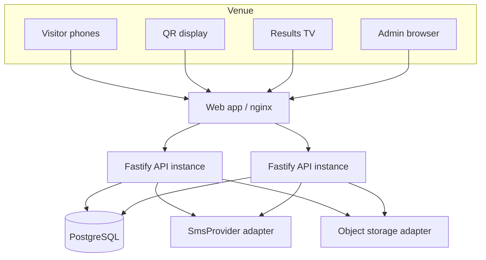

# Architecture

The current Compose file starts one API process for a compact local demo. The application is intentionally stateless: its cookies hold only random identifiers; visitor/admin/display session hashes, voting state, settings and audit events live in Postgres. Scale-out consists of adding API instances behind a TLS reverse proxy and a dedicated Postgres `LISTEN/NOTIFY` worker or Redis fan-out adapter.

## Components

| Component | Responsibility |
|---|---|
| React/Vite app | Responsive visitor, display and admin screens; cookies are never read by JavaScript. |
| Fastify API | Validation, signed presence redemption, OTP lifecycle, voting transaction, SSE and RBAC. |
| PostgreSQL | System of record and constraint boundary. `votes` is append-only and unique per `(round, visitor, category)`. |
| SmsProvider | Current local mock adapter contract; production requires a provisioned HTTP/SMS implementation. |

The QR display asks the API for a short-lived HMAC-signed URL. The visitor redeems it into a signed HttpOnly presence cookie. The voter’s phone is normalized, hash-indexed and encrypted before storage; the vote path re-evaluates presence/network policy and commits exactly one ballot per category in the transaction.
