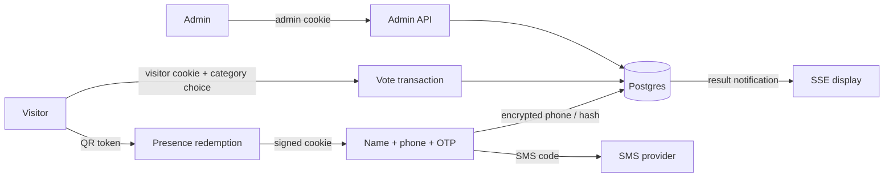

# Data flow diagram

Trust boundaries are browser↔TLS gateway, gateway↔API, and API↔external SMS/object storage. PII crosses only from registration to the API and encrypted database field; raw OTP and precise location must not enter logs.
