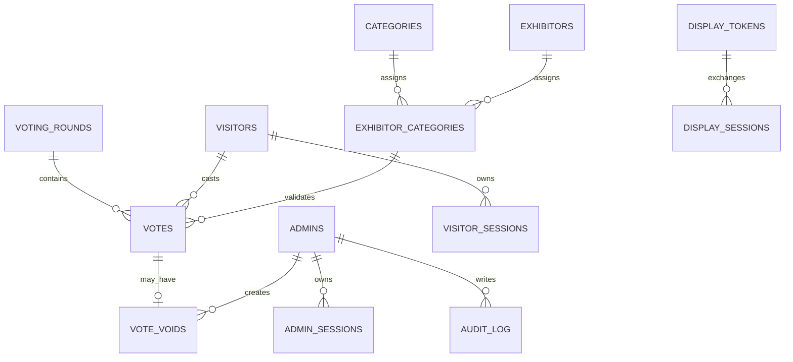

# Entity relationship diagram

`visitors.phone_enc` is ciphertext only; `phone_hash` is the unique peppered HMAC lookup. `votes.signals` contains coarse policy outcomes and distance/accuracy, never raw location.
